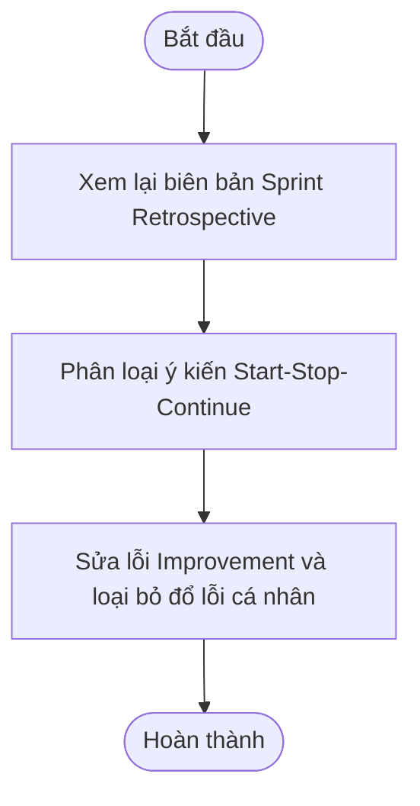

# [IT-206-K25] Bài 2 - Session 9: Phân loại và Sửa biên bản Sprint Retrospective

> 👤 **Học viên:** Hoàng Công Dũng | **Mã SV:** PTIT-HCM-009
> 🏫 **Môn học:** it206-k25-HoangCongDung

---

## 📊 Sơ đồ thiết kế hệ thống (Flowchart)

> 💡 *Sơ đồ dưới đây được render tự động trực tiếp trên GitHub bằng Mermaid. Bạn cũng có thể tải file **`bt2.drawio`** trong repository này để mở và chỉnh sửa trực tiếp trên [Draw.io (diagrams.net)](https://app.diagrams.net).* 

---

## Phần 1: Phân loại ý kiến

Dưới đây là bảng phân loại chi tiết các ý kiến từ R-01 đến R-07 trong biên bản Sprint Retrospective của Sprint 11, đảm bảo tách bạch rõ ràng giữa cách làm việc của Scrum Team và phản hồi về tính năng sản phẩm trợ lý AI RikkeiAssist theo đúng quy tắc nghiệp vụ.

- Các ý kiến về sản phẩm (tính năng, chỉ số AI) được chuyển về Product Backlog hoặc PO xử lý.
- Ý kiến chỉ trích cá nhân được viết lại theo hướng tập trung vào hành vi và hệ thống, tuyệt đối không đổ lỗi.

| Mã | Phân loại | Hướng xử lý và Viết lại (đối với R-03) |
| --- | --- | --- |
| R-01 | Phản hồi sản phẩm | Chuyển về Product Backlog cho Product Owner đánh giá tính năng thêm nút tự hủy đơn. |
| R-02 | Cần làm rõ | Viết lại thành hành động cụ thể: Thảo luận về việc chuẩn hóa kênh giao tiếp trong nhóm. |
| R-03 | Cách làm việc (Viết lại) | Viết lại không đổ lỗi: Khi cần thay đổi quy tắc, nhóm cần cập nhật tài liệu chung và thông báo thống nhất trước khi áp dụng thay vì tự ý thực hiện. |
| R-04 | Cách làm việc | Giữ lại ở cột Stop. Cần dừng ngay hành vi đổi quy tắc qua tin nhắn riêng mà không cập nhật tài liệu chung. |
| R-05 | Cách làm việc | Giữ lại ở cột Continue. Tiếp tục duy trì việc Pairing giữa tester và dev luồng hội thoại khi tái hiện lỗi. |
| R-06 | Phản hồi sản phẩm | Chuyển về Product Backlog / Chỉ số mục tiêu của Product Owner về độ chính xác của AI. |
| R-07 | Cách làm việc | Giữ lại ở cột Stop. Dừng ngay việc muốn hạ chuẩn Definition of Done chỉ để kịp tiến độ Sprint. |

## Phần 2: Sửa Improvement và Xử lý Improvement cũ

Sau khi rà soát 4 Improvement ban đầu (IM-11-01 đến IM-11-04), nhóm đã chọn lọc và viết lại 2 Improvement đạt tiêu chuẩn SMART (cụ thể, có người theo dõi, thời điểm kiểm tra và bằng chứng rõ ràng). Đồng thời, đưa ra phương án giải quyết dứt điểm Improvement cũ IM-10-02 từ Sprint 10.

- IM-11-01 và IM-11-02 quá mơ hồ, thiếu bằng chứng kiểm tra nên đã bị loại bỏ.
- IM-11-03 liên quan đến chỉ số sản phẩm AI, thuộc trách nhiệm của PO và Product Backlog.
- IM-11-04 được chọn và chuẩn hóa lại theo đúng cấu trúc yêu cầu.

| Hành động | Người/nhóm theo dõi | Khi kiểm tra | Bằng chứng |
| --- | --- | --- | --- |
| Khi đổi quy tắc chuyển người, cập nhật tài liệu chung trước khi triển khai | Scrum Master | Cuối Sprint 12 | Có phiên bản tài liệu cập nhật trên Git |
| Thực hiện Integration Test không muộn hơn Ngày 4 của Sprint | Khánh Vy và Nam | Ngày 4 của Sprint 12 | Log kết quả Integration Test trên CI/CD pipeline |

## Phần 3: Nhận xét cách điều phối

Buổi họp Sprint Retrospective của Sprint 11 có hai điểm chưa phù hợp nghiêm trọng trong cách điều phối của Scrum Master và Product Owner, ảnh hưởng trực tiếp đến tinh thần Agile:

1. Scrum Master mở đầu buổi họp bằng câu hỏi quy trách nhiệm cá nhân ('Ai đã làm sáu khiếu nại bị phân loại sai?'): Hành vi này vi phạm nguyên tắc cốt lõi của Retrospective là tìm lỗi hệ thống chứ không đổ lỗi cá nhân. Điều này gây tâm lý sợ hãi, phòng thủ, khiến thành viên ngừng phát biểu và làm mất đi không gian an toàn tâm lý (psychological safety).

2. Product Owner tự ý trả lời từng ý và tự chọn giải pháp thay vì để Scrum Team cùng thảo luận và quyết định: Điều này tước đi quyền tự quản (self-organization) và quyền cùng quyết định của Scrum Team, biến buổi họp thành nơi áp đặt từ trên xuống thay vì cải tiến từ dưới lên.

---

## 📁 Danh sách tệp tin nộp bài trong Repository
- 📝 `bt2.docx`: Báo cáo tài liệu phân tích nghiệp vụ hoàn chỉnh.
- 🎨 `bt2.drawio`: File thiết kế sơ đồ chuẩn theo quy định đề bài (mở trực tiếp bằng [Draw.io](https://app.diagrams.net) hoặc Lucidchart).
